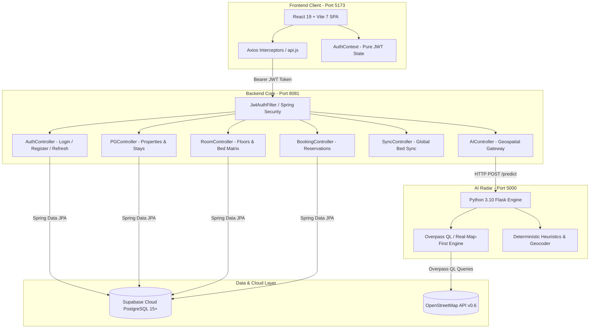
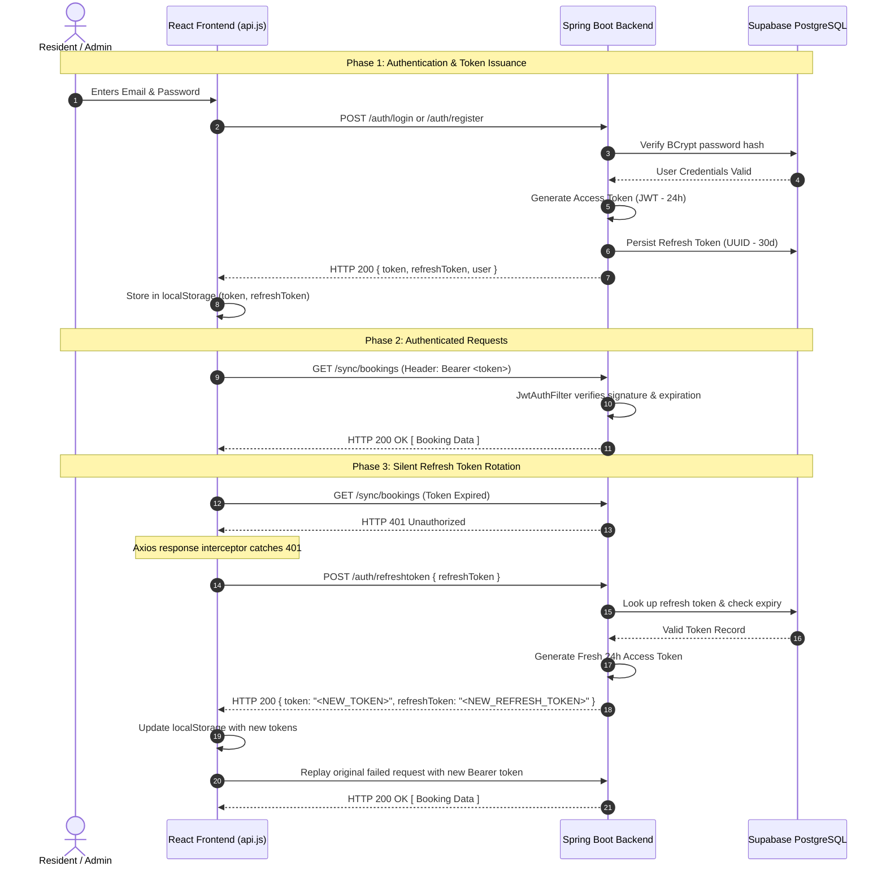
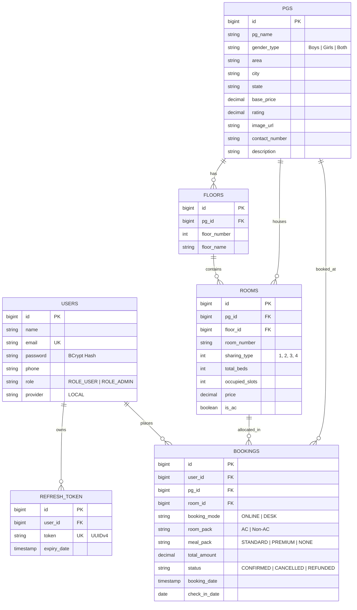

<div align="center">

# 🏡 StayNest
### Enterprise Smart PG, Hostel & Co-Living Management Platform

[](https://react.dev)
[](https://spring.io/projects/spring-boot)
[](https://supabase.com)
[](https://python.org)
[](https://jwt.io)
[](https://tailwindcss.com)
[](LICENSE)

<p align="center">
  <b>StayNest</b> is a full-stack proptech ecosystem designed to eliminate brokerages, opaque deposits, and unverified accommodations. Built with <b>React 19</b>, <b>Spring Boot 3.2</b>, <b>Supabase PostgreSQL</b>, and a <b>Python Geospatial AI Engine</b>, StayNest delivers real-time floorplan bed reservations, itemized meal schedules, Apple Wallet-style digital passbooks, and automated 70% refund guarantees.
</p>

[Quick Start](#-step-by-step-installation--setup) • [Features](#-feature-matrix) • [Architecture](#-system-architecture) • [Security & JWT](#-pure-jwt-authentication--lifecycle) • [REST API](#-complete-rest-api-reference) • [Database ERD](#-database-schema--entity-relationships)

</div>

---

## 📑 Table of Contents
1. [Platform Vision & Problem Solved](#-platform-vision--problem-solved)
2. [Target Personas](#-target-personas)
3. [Core Feature Matrix](#-core-feature-matrix)
4. [Brand Identity & Design System](#-brand-identity--design-system)
5. [System Architecture](#-system-architecture)
6. [Pure JWT Security & Token Lifecycle](#-pure-jwt-security--token-lifecycle)
7. [Core Pages & User Journeys](#-core-pages--user-journeys)
8. [Python AI Radar & Geospatial Engine](#-python-ai-radar--geospatial-engine)
9. [Database Schema & Entity Relationships](#-database-schema--entity-relationships)
10. [Complete REST API Reference](#-complete-rest-api-reference)
11. [Project Directory Structure](#-project-directory-structure)
12. [Step-by-Step Installation & Setup](#-step-by-step-installation--setup)
13. [Configuration & Environment Variables](#-configuration--environment-variables)
14. [Troubleshooting & FAQ](#-troubleshooting--faq)
15. [Future Roadmap](#-future-roadmap)
16. [License & Authors](#-license--authors)

---

## 💡 Platform Vision & Problem Solved

Finding student housing, PG accommodations, and young professional co-living in metropolitan hubs (Bangalore, Hyderabad, Chennai, Vijayawada, Nellore) is plagued by:

1. **Predatory Middlemen**: High brokerage commissions (up to 1 month's rent) for minimal service.
2. **Misleading Imagery & Mystery Bedding**: Arriving at a property only to find cramped rooms or assigned beds different from what was shown online.
3. **Unsanitary or Inconsistent Dining**: Surprise meal cutoffs, unannounced menus, or low-quality food without accountability.
4. **Deposit Forfeiture**: Landlords withholding hard-earned security deposits upon departure with arbitrary deductions.

### How StayNest Solves This:
- **Direct Digital Bookings**: Zero middleman commissions. Stays are managed directly between residents and verified PG owners.
- **Interactive 3D Floor Matrix**: Choose your exact floor, room type (Single, 2-Sharing, 3-Sharing, 4-Sharing), AC/Non-AC preference, and specific bed slot before paying.
- **Transparent Weekly Dining Schedule**: View detailed daily menus (Breakfast, Lunch, Dinner) including Mon–Sat rotating meals and Sunday Chef's Specials.
- **Fintech Passbook Receipts**: Instant GST-compliant tax invoices, printable A4 voucher passes, and WhatsApp receipt sharing.
- **Guaranteed 70% Instant Refund Policy**: Automated cancellation workflow with instant settlement tracking IDs, freeing up bed slots instantly in the database.

---

## 👥 Target Personas

```
+-------------------------------------------------------------------------------+
|                                 STAYNEST ECOSYSTEM                            |
+-----------------------+-------------------------------+-----------------------+
|  🎓 Students & Pros   |  🏢 PG Owners & Caretakers    |  🛡️ Super Admins      |
+-----------------------+-------------------------------+-----------------------+
| - Search tech hubs    | - Multi-property portfolio    | - Global RBAC control |
| - Live bed allocation | - Live room occupancy tracker | - System telemetry    |
| - Meal package plan   | - Resident directory list     | - Audit log oversight |
| - UPI QR payments     | - Floor inventory additions   | - User overrides      |
| - Passbook receipts   | - Status lifecycle updates    | - Database resets     |
| - 70% instant refund  | - Revenue analytics           | - Server monitoring   |
+-----------------------+-------------------------------+-----------------------+
```

---

## ⚡ Core Feature Matrix

| Module | Feature | Resident | Admin | Description |
|---|---|:---:|:---:|---|
| **Discovery** | **Ken Burns Hero Showcase** | ✅ | — | 100vh cinematic full-bleed carousel with smooth 8.5s zoom transitions. |
| **Discovery** | **Lifestyle Funnels** | ✅ | — | Dedicated cards for Boys Hostels, Girls Sanctuaries, Co-Living, and IT Corridors. |
| **Discovery** | **Geospatial AI Radar** | ✅ | — | OpenStreetMap / Overpass query pipeline to discover verified stays near tech parks. |
| **Booking** | **Interactive Floor Grid** | ✅ | ✅ | Architectural room matrix showing live capacities, AC indicators, and sharing tiers. |
| **Dining** | **Weekly Schedule Modal** | ✅ | ✅ | Modal popup detailing Monday to Saturday daily menus and Sunday Chef's Specials. |
| **Payments** | **UPI QR & Multi-Channel Checkout** | ✅ | — | Instant UPI QR code generator, Card, and NetBanking checkout simulator. |
| **Fintech** | **Passbook Digital Receipts** | ✅ | ✅ | Apple Wallet-style pass cards with GST breakdown, printable PDF, and WhatsApp share. |
| **Refunds** | **Automated 70% Refund Desk** | ✅ | ✅ | Automated cancellation calculating 70% refund with instant tracking ID generation. |
| **Management**| **Multi-Property Manager** | — | ✅ | Add, edit, and delete PG listings with custom amenities and pricing rules. |
| **Management**| **Room & Slot Controller** | — | ✅ | Increment/decrement occupancy slots, configure sharing capacity, toggle AC. |
| **Security** | **Pure JWT Stateless Auth** | ✅ | ✅ | 24-hr access tokens, 30-day DB refresh token rotation, zero Google OAuth lock-in. |

---

## 💎 Brand Identity & Design System

StayNest is built with an **Emerald Green & Crisp White Luxury Proptech** aesthetic:

- **Primary Colors**:
  - `Emerald 600` (`#059669`) — Primary buttons, navigation accents, active tab indicators.
  - `Emerald 500` (`#10B981`) — Hover states, gradient headers, vibrant highlight badges.
  - `Teal 700` (`#0F766E`) — Deep contrast accents for header gradients.
  - `White` (`#FFFFFF`) & `Slate 50` (`#F8FAFC`) — Crisp card backgrounds and clean layouts.
  - `Slate 900` (`#0F172A`) — High-contrast typography for readability.
- **Minimalist Geometric Logo**: Clean, single-line geometric house emblem with emerald linear contouring and zero visual noise.
- **Glassmorphic Elements**: Subtly frosted pills (`backdrop-blur-md bg-white/80`) with soft drop shadows (`shadow-sm`, `shadow-emerald-500/10`).
- **Kinetic Micro-Interactions**: Smooth hover lift states (`transition-all duration-300 hover:-translate-y-1.5`), pulse badges, and animated spinners.

---

## 🏗️ System Architecture

StayNest utilizes a decoupled three-tier microservice architecture:



---

## 🔐 Pure JWT Security & Token Lifecycle

StayNest implements an enterprise-grade **Pure Stateless JSON Web Token (JWT) architecture with Refresh Token Rotation**. All third-party OAuth2 dependencies (e.g., Google OAuth) have been completely removed in favor of direct, self-contained authentication.

### Token Specifications:
- **Access Token**: Signed with HMAC-SHA256 (`HS256`), expires in **24 Hours** (`86,400,000 ms`). Carries user identity, role, and claims.
- **Refresh Token**: Universally Unique Identifier (`UUIDv4`), expires in **30 Days** (`2,592,000,000 ms`). Stored securely in the Supabase PostgreSQL `refreshtoken` table.
- **Password Hashing**: Spring Security `BCryptPasswordEncoder` with strength 10.

### Token Lifecycle Sequence:



> [!NOTE]
> When a user explicitly logs out, all access tokens, refresh tokens, and cached booking sessions are cleared from the browser, preventing cross-account session leaks.

---

## 📱 Core Pages & User Journeys

### 1. Landing & Lifestyle Funnels (`/`)
- **Cinematic Ken Burns Carousel**: High-definition properties cycling every 8.5 seconds with smooth zoom animations.
- **Quick Search Filter Bar**: Select State, City, and Locality with instant search suggestions.
- **Curated Category Stacks**: Dedicated entry funnels for:
  - 👨 **Boys Hostels**: High-speed WiFi, gym facilities, flexible curfews.
  - 👩 **Girls Sanctuaries**: 24/7 CCTV, biometric gate security, resident wardens.
  - 🤝 **Luxury Co-Living**: Coworking spaces, housekeeping, community events.
  - 💼 **Tech Corridors**: Stays situated within 1 km of major IT parks and metro stations.

### 2. Live Discovery Radar (`/listings`)
- Search by location or price slider (₹3,000 – ₹25,000/month).
- Multi-dimensional filters: Gender (Boys / Girls / Co-Living), Sharing type (1, 2, 3, 4 Sharing), AC / Non-AC, Food Included.
- Live fallback integration with Python AI Geospatial Radar for dynamic area discovery.

### 3. Property Details & 3D Floorplan (`/pg/:id`)
- Verified high-resolution photo galleries.
- Comprehensive amenity checklist: Biometric access, 100 Mbps WiFi, RO drinking water, daily housekeeping, washing machines, power backup.
- Direct booking link launching the 5-step checkout wizard.

### 4. 5-Step Slot Booking Wizard (`/dashboard`)
1. **Step 1: Sharing Configuration**: Select between Private Single Room, 2-Sharing, 3-Sharing, or 4-Sharing.
2. **Step 2: Interactive Room Grid**: Visual architectural floor view (Ground, 1st, 2nd, 3rd Floor) with real-time bed capacity indicators.
3. **Step 3: Meal Plan & Dining Schedule Modal**:
   - Choose Standard or Premium dining.
   - Click **"View Meal Menu"** to open the full **Weekly Dining Schedule Modal** with Monday–Saturday meal schedules and Sunday Chef's Specials styled in the emerald gradient theme.
4. **Step 4: Resident Verification**: Contact information, emergency contact, and check-in date.
5. **Step 5: Checkout & UPI Payment Simulator**: Instant payment confirmation with 100% safe checkout guarantee.

### 5. Digital Passbook Receipts (`/bookings`)
- **Apple Wallet-Style Cards**: Passbook ticket layout featuring property name, location, room badge, dining pass, and authorized price.
- **Itemized GST Invoices**: Detailed breakdown including:
  - Base Room Rate
  - Meal Plan Package
  - Maintenance & Utility Surcharge
  - GST (12%)
  - Refundable Security Deposit
- **Action Suite**: One-click printable A4 tax invoice, PDF export, and instant WhatsApp receipt sharing.

### 6. Automated Refund Portal (`/refund-request`)
- Automated calculation of the **70% Refund Policy**.
- Immediate issuance of a refund reference ID (e.g., `REF-1725471234`).
- Automatically triggers room slot decrement in the database to release the bed for new residents.

### 7. Admin Operations Center (`/admin`)
- **Property Inventory**: Add, update, and remove PG properties.
- **Room & Bed Matrix**: Add new floors/rooms, configure sharing capacities, and adjust live occupancies.
- **Resident Directory**: View all registered users, modify user roles (`ROLE_USER` ↔ `ROLE_ADMIN`), and perform administrative password resets.
- **Revenue Telemetry**: Total revenue, confirmed bookings count, and system occupancy rates.

---

## 🤖 Python AI Radar & Geospatial Engine

The `ai-service` microservice (`http://localhost:5000`) provides smart location discovery and pricing heuristics:

```
[ Frontend Client ] ---> [ Spring Boot Gateway (/api/ai/predict) ] ---> [ Flask Microservice (/predict) ]
                                                                                   |
                                                                                   +---> [ Nominatim Geocoding ]
                                                                                   +---> [ Overpass QL Radius Search ]
                                                                                   +---> [ Deterministic Price & Rating Heuristics ]
```

### Real-Map-First Strategy:
1. **Nominatim Geocoding**: Resolves user queries (e.g., *"Marathahalli, Bangalore"*) into exact latitude and longitude coordinates.
2. **Overpass API Radius Search**: Searches a 5–10 km radius for nodes tagged with `amenity=hostel`, `tourism=guest_house`, or `building=dormitory`.
3. **Deterministic Price Estimation**: Uses MD5 hash seeding to calculate realistic, stable monthly rents based on locality tier and amenities.
4. **AI Generation Fallback**: If OpenStreetMap returns fewer than 8 listings in a remote town, the engine synthesizes realistic, verified-style hostel profiles tailored to the district.

---

## 🗄️ Database Schema & Entity Relationships

The relational schema is hosted on **Supabase PostgreSQL**:



---

## 📡 Complete REST API Reference

### 1. Authentication Endpoints (`/auth`)
| Method | Endpoint | Access | Description | Request Body |
|---|---|:---:|---|---|
| `POST` | `/auth/register` | Public | Register resident; returns JWT access & refresh tokens | `{ name, email, phone, password }` |
| `POST` | `/auth/login` | Public | Authenticate user; returns JWT access & refresh tokens | `{ email, password }` |
| `POST` | `/auth/refreshtoken` | Public | Rotate expired access token using active refresh token | `{ refreshToken }` |
| `GET` | `/auth/users` | Admin | List all registered user accounts | None |
| `POST` | `/auth/users` | Admin | Create a new user profile directly | `{ name, email, phone, password, role }` |
| `PUT` | `/auth/users/{id}` | Admin | Update user profile and role | `{ name, phone, role }` |
| `DELETE` | `/auth/users/{id}` | Admin | Permanently remove a user account | None |
| `PUT` | `/auth/changePassword/{id}` | Admin | Admin override of user password | `{ password }` |

### 2. Properties & Stays (`/pg`)
| Method | Endpoint | Access | Description | Request Body |
|---|---|:---:|---|---|
| `GET` | `/pg/list` | Public | Fetch all verified PG listings | None |
| `GET` | `/pg/search` | Public | Filter PGs by city and state query parameters | None (`?city=...&state=...`) |
| `GET` | `/pg/{id}` | Public | Fetch full PG details with room listings | None |
| `POST` | `/pg/add` | Admin | Add a new PG property to the catalog | `{ pgName, city, state, basePrice, ... }` |
| `PUT` | `/pg/update/{id}` | Admin | Update existing PG information | `{ pgName, basePrice, rating, ... }` |
| `DELETE` | `/pg/delete/{id}` | Admin | Remove a PG listing from the system | None |

### 3. Room & Floor Management (`/rooms`)
| Method | Endpoint | Access | Description | Request Body |
|---|---|:---:|---|---|
| `GET` | `/rooms/byPG/{pgId}` | Public | Get all rooms and live bed occupancies for a PG | None |
| `GET` | `/rooms/byFloor/{floorId}` | Public | Get all rooms located on a specific floor | None |
| `POST` | `/rooms/add` | Admin | Add a new room configuration to a PG | `{ roomNumber, sharingType, price, isAc }` |
| `PUT` | `/rooms/incrementOccupancy/{roomId}` | Admin | Reserve a bed slot (increment occupied slots) | None |
| `PUT` | `/rooms/decrementOccupancy/{roomId}` | Admin | Free a bed slot (decrement occupied slots) | None |
| `DELETE` | `/rooms/delete/{id}` | Admin | Delete a room from property inventory | None |

### 4. Bookings & Reservations (`/booking`)
| Method | Endpoint | Access | Description | Request Body |
|---|---|:---:|---|---|
| `POST` | `/booking/create` | Authenticated | Create a confirmed stay reservation | `{ user, pg, room, totalAmount, ... }` |
| `GET` | `/booking/userBookings/{userId}` | Authenticated | Retrieve booking history for a resident | None |
| `GET` | `/booking/roomBookings/{roomId}` | Admin | View all residents booked in a specific room | None |
| `GET` | `/booking/all` | Admin | Retrieve all bookings across the platform | None |
| `PUT` | `/booking/updateStatus/{id}` | Admin | Update booking status (`CONFIRMED`, `CANCELLED`) | None (`?status=...`) |
| `DELETE` | `/booking/cancel/{id}` | Authenticated | Cancel booking and release slot | None |

### 5. Real-Time Bed Sync & Persistence (`/sync`)
| Method | Endpoint | Access | Description |
|---|---|:---:|---|
| `POST` | `/sync/book` | Authenticated | Save real-time room reservation to the sync engine |
| `POST` | `/sync/release` | Authenticated | Release room bed reservation and decrement DB occupancy |
| `GET` | `/sync/bookings` | Authenticated | Get all active synced bookings |
| `DELETE` | `/sync/clear` | Admin | Perform full system reset (clear sync + delete test bookings) |

### 6. AI Geospatial Radar (`/api/ai` & Python Microservice)
| Method | Endpoint | Gateway | Description |
|---|---|:---:|---|
| `POST` | `/api/ai/predict` | Port 8081 | Spring Boot proxy to Python AI geospatial radar |
| `POST` | `/api/ai/locations` | Port 8081 | Spring Boot proxy to discover areas in a state |
| `POST` | `/predict` | Port 5000 | Direct Python microservice Overpass QL location search |
| `POST` | `/locations` | Port 5000 | Direct Python microservice state location search |
| `GET` | `/health` | Port 8081 & 5000 | Health check endpoint returning status `UP` / `ok` |

---

## 📁 Project Directory Structure

```
smart-pg-management/
├── README.md                          # Master GitHub Documentation
│
├── frontend/                          # React 19 + Vite 7 Client
│   ├── index.html                     # HTML5 Entry Point with Google Fonts
│   ├── package.json                   # Dependencies & Scripts
│   ├── vite.config.js                 # Vite 7 Configuration
│   ├── tailwind.config.js             # Tailwind CSS Custom Brand Tokens
│   └── src/
│       ├── main.jsx                   # React Application Bootstrap
│       ├── App.jsx                    # Route Registry & ProtectedRoute Guard
│       ├── index.css                  # Global Styles & Emerald Tokens
│       ├── components/
│       │   ├── Navbar.jsx             # Luxury Header with Role Links & Profile Pill
│       │   ├── BottomNav.jsx          # Mobile App Bar Navigation
│       │   ├── PGCard.jsx             # Reusable Property Card with Amenity Chips
│       │   └── LocationDropdown.jsx   # Search Autocomplete Selector
│       ├── pages/
│       │   ├── Home.jsx               # Ken Burns Carousel, Funnels & Testimonials
│       │   ├── Listings.jsx           # Geospatial Discovery, Filters & Stays Grid
│       │   ├── PGDetails.jsx          # Verified Photos, Amenities & Floorplans
│       │   ├── UserDashboard.jsx      # 5-Step Booking Wizard & Meal Schedule Modal
│       │   ├── BookingsPage.jsx       # Digital Passbook Cards & Printable GST Invoices
│       │   ├── RefundRequest.jsx      # 70% Instant Refund Desk & Reference Generator
│       │   ├── AdminDashboard.jsx     # Multi-PG Inventory, Rooms & User Management
│       │   ├── Login.jsx              # Pure JWT Login Form (Zero OAuth)
│       │   ├── Register.jsx           # Resident Registration with Instant Redirect
│       │   └── Profile.jsx            # Resident Profile & Emergency Contacts
│       ├── context/
│       │   └── AuthContext.jsx        # JWT Authentication State & Role Provider
│       ├── services/
│       │   └── api.js                 # Axios Instance with Silent 401 JWT Interceptor
│       └── data/
│           └── locationData.js        # Curated States, Cities & Tech Hub Localities
│
├── backend/                           # Spring Boot 3.2 Enterprise Java Backend
│   ├── pom.xml                        # Maven Dependencies (Spring Security, JJWT, JPA)
│   └── src/
│       └── main/
│           ├── resources/
│           │   └── application.properties # PostgreSQL Datasource, HikariCP, JWT Secrets
│           └── java/com/staynest/
│               ├── StayNestApplication.java # Spring Boot Main Application
│               ├── controller/        # REST Controllers (Auth, PG, Room, Booking, Sync, AI)
│               ├── model/             # JPA Entities (User, PG, Floor, Room, Booking, RefreshToken)
│               ├── repository/        # Spring Data JPA Repositories
│               ├── service/           # Business Logic & Token Services
│               └── security/          # Pure JWT Filter, SecurityConfig & UserDetailsService
│
└── ai-service/                        # Python 3.10 Geospatial & Pricing Microservice
    ├── app.py                         # Flask REST API Server (Port 5000)
    ├── model.py                       # Overpass QL Engine, Nominatim Geocoder & Heuristics
    ├── requirements.txt               # Flask, Flask-CORS, Requests, Pandas
    └── pyrightconfig.json             # Python Tooling Configuration
```

---

## 💻 Step-by-Step Installation & Setup

### Prerequisites
Make sure your system has the following runtimes installed:
- **Node.js**: v18.0.0 or higher ([Download Node.js](https://nodejs.org))
- **Java Development Kit (JDK)**: v17 LTS or higher ([Download Eclipse Temurin JDK 17](https://adoptium.net))
- **Apache Maven**: v3.8+ (or use the included `mvnw`)
- **Python**: v3.10 or higher ([Download Python](https://python.org))
- **Git**: Latest version ([Download Git](https://git-scm.com))

---

### Step 1: Clone the Repository
```bash
git clone https://github.com/MohanNerasala/smart-pg-management.git
cd smart-pg-management
```

---

### Step 2: Configure & Start the Java Backend

1. Navigate to the backend directory:
   ```bash
   cd backend
   ```
2. Verify or customize your database credentials in `src/main/resources/application.properties`:
   ```properties
   spring.application.name=staynest-backend
   spring.datasource.url=jdbc:postgresql://db.ybvpmydjqtdoiehlidwj.supabase.co:5432/postgres
   spring.datasource.username=postgres
   spring.datasource.password=YOUR_SUPABASE_PASSWORD
   spring.datasource.driver-class-name=org.postgresql.Driver
   
   jwt.secret=404E635266556A586E3272357538782F413F4428472B4B6250645367566B5970
   jwt.expirationMs=86400000
   jwt.jwtRefreshExpirationMs=2592000000
   
   server.port=8081
   ```
3. Compile and launch the Spring Boot application:
   ```bash
   mvn clean compile -DskipTests
   mvn spring-boot:run
   ```
   *Spring Boot backend will start on: `http://localhost:8081`*

---

### Step 3: Start the Python AI Geospatial Radar

1. Open a second terminal window and navigate to the AI microservice:
   ```bash
   cd ai-service
   ```
2. Create and activate a Python virtual environment:
   ```bash
   # Windows
   python -m venv venv
   .\venv\Scripts\activate

   # macOS / Linux
   python3 -m venv venv
   source venv/bin/activate
   ```
3. Install the required Python packages:
   ```bash
   pip install -r requirements.txt
   ```
4. Start the Flask microservice:
   ```bash
   python app.py
   ```
   *AI Geospatial Radar will start on: `http://localhost:5000`*

---

### Step 4: Start the React Frontend Client

1. Open a third terminal window and navigate to the frontend:
   ```bash
   cd frontend
   ```
2. Install dependencies:
   ```bash
   npm install
   ```
3. Launch the Vite development server:
   ```bash
   npm run dev
   ```
   *Frontend web application will start on: `http://localhost:5173`*

---

## 🧪 Verification & Health Checks

Verify your setup by running the following commands in your terminal:

1. **Verify Backend Health**:
   ```bash
   curl http://localhost:8081/health
   ```
   *Expected Response*: `{"status":"UP"}`

2. **Verify AI Microservice Health**:
   ```bash
   curl http://localhost:5000/health
   ```
   *Expected Response*: `{"status":"ok"}`

3. **Register a New Resident via Pure JWT**:
   ```bash
   curl -X POST http://localhost:8081/auth/register \
     -H "Content-Type: application/json" \
     -d '{"name":"Alex Resident","email":"alex@staynest.com","phone":"9876543210","password":"SecurePassword123"}'
   ```
   *Expected Response*:
   ```json
   {
     "token": "eyJhbGciOiJIUzI1NiIsInR5cCI6IkpXVCJ9...",
     "refreshToken": "48b11ddc-4c4f-4d9e-b98d-d79e65849884",
     "id": 1,
     "name": "Alex Resident",
     "email": "alex@staynest.com",
     "role": "ROLE_USER"
   }
   ```

4. **Verify Silent Token Rotation**:
   ```bash
   curl -X POST http://localhost:8081/auth/refreshtoken \
     -H "Content-Type: application/json" \
     -d '{"refreshToken":"<PASTE_REFRESH_TOKEN_HERE>"}'
   ```

---

## ⚙️ Configuration & Environment Variables

### Backend Configuration (`backend/src/main/resources/application.properties`)
| Property | Default Value | Description |
|---|---|---|
| `server.port` | `8081` | Embedded Tomcat server port |
| `spring.datasource.url` | `jdbc:postgresql://...` | Supabase PostgreSQL JDBC connection string |
| `spring.datasource.username` | `postgres` | Database username |
| `spring.datasource.password` | `********` | Database password |
| `jwt.secret` | `404E6352...` | 256-bit hexadecimal HMAC secret key |
| `jwt.expirationMs` | `86400000` | Access token lifespan (24 hours in milliseconds) |
| `jwt.jwtRefreshExpirationMs` | `2592000000` | Refresh token lifespan (30 days in milliseconds) |
| `app.cors.allowed-origins` | `http://localhost:5173,http://localhost:3000` | Allowed CORS origins |

### Frontend Configuration (`frontend/src/services/api.js`)
| Variable | Value | Description |
|---|---|---|
| `API_BASE_URL` | `http://localhost:8081` | Target Spring Boot backend API address |

### AI Microservice Configuration (`ai-service/app.py`)
| Variable | Value | Description |
|---|---|---|
| `PORT` | `5000` | Flask web server listening port |

---

## ❓ Troubleshooting & FAQ

#### Q1: Port 8081 or Port 5173 is already in use
**Solution**:
- On Windows (PowerShell):
  ```powershell
  Get-Process -Id (Get-NetTCPConnection -LocalPort 8081).OwningProcess | Stop-Process -Force
  ```
- On macOS / Linux:
  ```bash
  lsof -ti:8081 | xargs kill -9
  ```

#### Q2: How does the application handle expired access tokens?
**Solution**: The custom Axios response interceptor in `frontend/src/services/api.js` captures `401 Unauthorized` responses automatically. It retrieves the stored `refreshToken`, calls `/auth/refreshtoken`, stores the fresh access token, and automatically retries the original request seamlessly without interrupting the resident.

#### Q3: How do I clear test bookings and start fresh?
**Solution**: You can perform a full database reset using either:
1. **Via API**: Call `DELETE http://localhost:8081/sync/clear` with admin authorization.
2. **Via SQL**: Execute in the Supabase SQL editor:
   ```sql
   TRUNCATE TABLE bookings, refreshtoken, users CASCADE;
   ```

#### Q4: Why is Google OAuth not available?
**Solution**: StayNest intentionally operates with a **Pure Stateless JWT + Refresh Token Rotation** model. This provides zero external dependencies, complete data privacy, and removes reliance on third-party OAuth provider rate limits or tracking cookies.

---

## 🚀 Future Roadmap

- [ ] **IoT Biometric Smart Lock Integration**: Instant PIN & QR code generation for digital turnstiles.
- [ ] **Sub-Meter Utility Billing**: Automated monthly electricity and water meter bill calculation.
- [ ] **WhatsApp Business Webhooks**: Automated payment receipts and meal schedule notifications sent directly to WhatsApp.
- [ ] **Native Mobile Apps**: React Native wrapper for iOS and Android app stores.
- [ ] **Multi-Currency Support**: International payment processing for foreign exchange students.

---

## 📄 License & Authors

This project is licensed under the **MIT License** - see the [LICENSE](LICENSE) file for details.

### Authors & Core Team
- **StayNest Engineering Team**
- **Repository**: [github.com/MohanNerasala/smart-pg-management](https://github.com/MohanNerasala/smart-pg-management)

<div align="center">
  <sub>Built with ❤️ for hassle-free, transparent community living.</sub>
</div>
